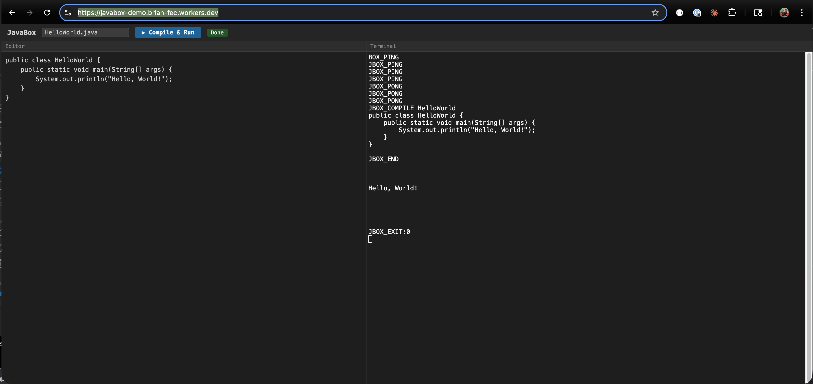
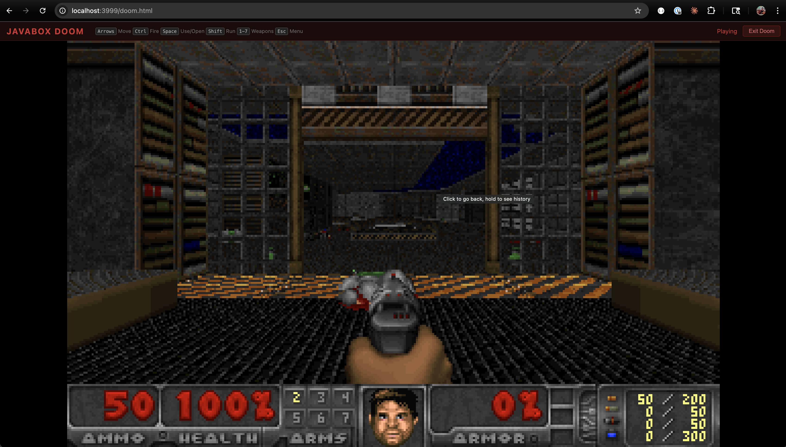

# JavaBox

Run Java in the browser. No server-side JVM required.

**[Live Demo](https://javabox-demo.brian-fec.workers.dev/)**



JavaBox runs OpenJDK 21 (Zero interpreter) directly in WebAssembly via Emscripten. Write, compile, and execute Java code entirely inside the browser tab — no backend needed.

## Quick start (run the demo locally)

Run the deployed prebuilt artifacts without building from source:

```sh
./build/fetch-prebuilt.sh ~/javabox-wasm
python3 build/serve.py ~/javabox-wasm 3000
# http://localhost:3000/index.html   — Java editor + terminal
# http://localhost:3000/doom.html    — Doom
```

`build/serve.py` is required: the runtime needs `SharedArrayBuffer`, which requires the `Cross-Origin-Opener-Policy: same-origin` and `Cross-Origin-Embedder-Policy: require-corp` headers. A plain static file server will not work. The prebuilt artifacts are downloaded from <https://javabox-demo.brian-fec.workers.dev> (~76MB).

## Doom in the Browser

JavaBox can run [Mocha Doom](https://github.com/axelkohlmeyer/mochadoom) — a pure-Java Doom engine — rendered to an HTML Canvas at ~30 FPS with keyboard input and sound effects.



<video src="docs/doom.mp4" controls width="100%"></video>

**[Play Doom](https://javabox-demo.brian-fec.workers.dev/doom.html)**

## How It Works

```
Browser tab
  └── Emscripten WASM module (~3MB code + ~72MB data)
        └── OpenJDK 21 Zero interpreter (compiled to WASM)
              └── CompileServer (persistent JVM daemon)
                    ├── javax.tools.JavaCompiler (compile)
                    ├── URLClassLoader (run)
                    └── Mocha Doom (Canvas rendering + Web Audio)
```

A persistent **CompileServer** daemon runs inside the JVM. Compilation and execution happen in-process via `javax.tools.JavaCompiler` and `URLClassLoader`, avoiding JVM startup overhead entirely.

**Performance:** ~3-5s boot, sub-second compile+run.

### Doom Architecture

Doom runs entirely in Java with zero native UI dependencies:

- **Video:** Java renders to `BufferedImage` → JNI native copies ARGB pixels to shared WASM heap as RGBA → browser `requestAnimationFrame` draws via `putImageData`
- **Audio:** Java 8-channel mixer produces 16-bit stereo PCM (22050Hz) → JNI native writes to shared ring buffer → browser Web Audio API plays via `AudioBufferSourceNode`
- **Input:** Browser posts key events directly to a C-side queue via WASM export → Java polls the queue each frame via JNI — no Java threads needed (Emscripten pthread creation is unreliable)

## Repository Structure

```
openjdk/            OpenJDK 21u git submodule (wasm-emscripten branch — carries the Emscripten port)
third-party/
  libffi-emscripten/ libffi git submodule for the Emscripten build
container/          Dockerfile + CompileServer + Doom adapter classes
  doom/             Mocha Doom source + adapter (TerminalEngine, CanvasRenderer)
build/              Build scripts (compile, link, deploy, serve)
  build-direct.sh   Orchestrate the full direct WASM build
  build-jdk-native.sh  Build JDK native static libraries
  jdk-detect.sh     Detect the required JDK installations
  fetch-prebuilt.sh Download deployed WASM artifacts
  jvm-main.c        JVM entry point + stdin bridge + Canvas/Audio/Input native methods
  CompileServer.java  In-memory compilation daemon
web/                Frontend (index.html editor, doom.html game)
packages/
  sdk/              TypeScript SDK (@javabox/sdk)
tests/              Playwright e2e tests
```

## Prerequisites

| Tool | Purpose | Install |
|------|---------|---------|
| [Emscripten SDK](https://emscripten.org) | Compile OpenJDK to WASM (`emcc`; tested with 5.0.2) | [emsdk](https://emscripten.org/docs/getting_started/downloads.html) |
| Boot JDK 20 or 21 | Compile OpenJDK 21 | Set `JAVABOX_BOOT_JDK` to override detection |
| JDK 21 (exactly) | Build the JDK 21 class library with jlink | `brew install openjdk@21`; set `JAVABOX_JDK21_HOME` to override detection |
| Host `javac` 21+ | Compile Java sources with `--release 21` | Install a JDK 21 or newer |
| Autotools + GNU grep | Build libffi and configure OpenJDK | macOS: `brew install autoconf automake libtool grep openjdk@21` |
| Node.js 20+ | Playwright e2e tests | `brew install node` |
| Python 3 | Local server | Install `python3` |

`emcc` must be on `PATH`; `build-direct.sh` also sources `~/emsdk/emsdk_env.sh` when available. JDK detection is implemented in `build/jdk-detect.sh`: override, `$JAVA_HOME`, macOS `java_home`, Homebrew, Linux `/usr/lib/jvm`, then `java` on `PATH`. It fails with an actionable message instead of silently selecting the wrong JDK. On macOS, OpenJDK configure requires GNU grep (`ggrep`).

## Build from source

Clone the submodules with the repository:

```sh
git clone --recursive https://github.com/bmarti44/javabox.git
cd javabox
```

For an existing clone:

```sh
git submodule update --init --recursive
```

### Full build (recommended)

```sh
./build/build-direct.sh <output-dir> [--with-doom] [--clean] [--release]
./build/build-direct.sh ~/javabox-wasm --with-doom
```

### Individual steps

The entry point runs these five steps:

1. `build-jvm-wasm.sh` — build libffi, configure OpenJDK Zero, and build HotSpot `libjvm.a`.
2. `build-jdk-native.sh` — build java.base's native archives (`libjava.a`, `libnio.a`, `libzip.a`, `libjimage.a`).
3. `build-jdk-modules.sh` — use jlink to build the JDK 21 class library.
4. `build-doom-jar.sh` — optionally compile the Doom Java sources.
5. `link-direct-wasm.sh` — final emcc link to `javabox-direct.mjs`, `.wasm`, and `.data`.

Expect the first build to take a while — step 1 compiles all of HotSpot. Later
runs are incremental.

### Doom assets

`build-doom-jar.sh` compiles the Doom Java sources from `container/doom/`, but the
IWAD is not redistributed here. Drop [Freedoom](https://freedoom.github.io)'s
`freedoom1.wad` into `container/doom/` before building with `--with-doom`:

```sh
curl -sL -o /tmp/freedoom.zip \
  https://github.com/freedoom/freedoom/releases/download/v0.13.0/freedoom-0.13.0.zip
unzip -j /tmp/freedoom.zip 'freedoom-0.13.0/freedoom1.wad' -d container/doom/
```

Without it the module still builds and `index.html` works; only `doom.html` is
affected.

### Serve locally

The WASM files require `Cross-Origin-Opener-Policy: same-origin` and `Cross-Origin-Embedder-Policy: require-corp` headers for `SharedArrayBuffer`.

```sh
python3 build/serve.py ~/javabox-wasm 3000
# http://localhost:3000/index.html    — Java editor + terminal
# http://localhost:3000/doom.html     — Doom
```

## Deploy to Cloudflare

```sh
npm install --userconfig /dev/null wrangler
npx --userconfig /dev/null wrangler login
./build/deploy-cloudflare.sh ~/javabox-wasm
```

## Architecture

### CompileServer

The key innovation is a persistent JVM daemon (`build/CompileServer.java`) that:

1. Compiles Java source in-process via `javax.tools.JavaCompiler` with an in-memory file manager
2. Runs compiled classes in-process via custom `MemoryClassLoader` (defineClass from byte[])
3. Responds to a simple line protocol over stdin/stdout

Protocol:
- **Boot detection:** Browser sends `JBOX_PING`, CompileServer responds `JBOX_PONG`
- **Compile+Run:** `JBOX_COMPILE <ClassName>\n<source>\nJBOX_END\n` → output + `JBOX_EXIT:<code>`
- **Doom:** `JBOX_DOOM\n` → starts Mocha Doom in-process with Canvas rendering

### Direct WASM Mode

OpenJDK 21's Zero interpreter (pure C++ bytecode interpreter, no JIT) is compiled to WebAssembly via Emscripten. Key technical details:

- **Threading:** `PROXY_TO_PTHREAD` runs main() on a Web Worker; Emscripten pthread pool provides additional workers
- **Memory:** 256MB initial, 512MB max, Serial GC
- **Stdin bridge:** SharedArrayBuffer ring buffer with `Atomics.wait`/`Atomics.notify` for browser→JVM communication
- **Static linking:** All native libraries (libjvm, libjava, libjimage, libzip, libnio, libffi) linked into one WASM binary
- **Symbol dispatch:** Static symbol table with binary search replaces `dlsym` for JNI native method resolution

## Known Constraints

- **Interpreter only:** Zero interpreter (no JIT) — sufficient for interactive use
- **Memory:** 512MB max heap
- **Emscripten pthreads:** JVM internal threads (Finalizer, GC) may fail to start; game loop and compilation work on the main pthread
- **Browser support:** Requires SharedArrayBuffer — Chrome 92+, Firefox 79+, Safari 15.2+, Edge 92+

## Development

```sh
# Type-check the SDK
cd packages/sdk && npx tsc --noEmit

# Run e2e tests (requires local server on port 3999)
npx playwright test tests/doom-canvas-diag.spec.js
npx playwright test tests/e2e-debug.spec.js
```
